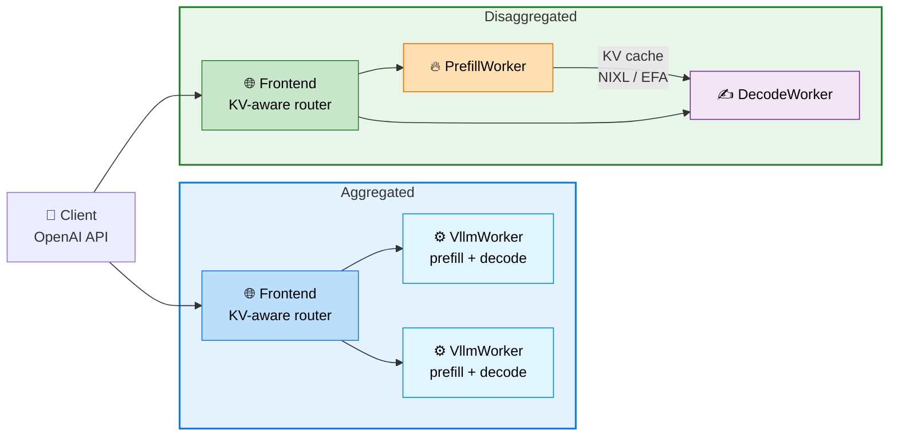
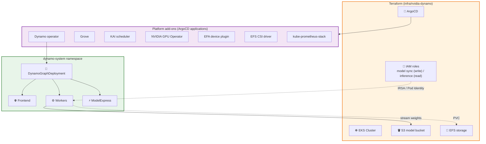
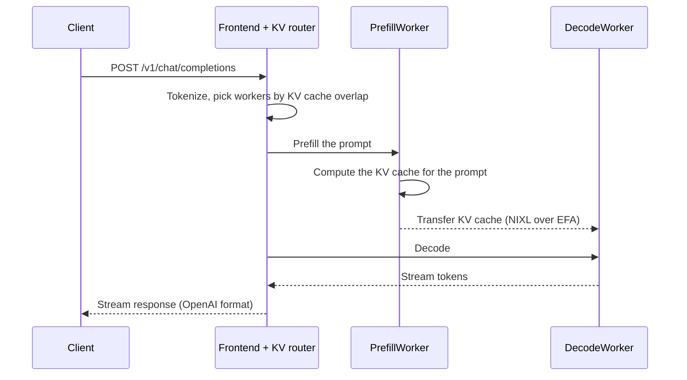
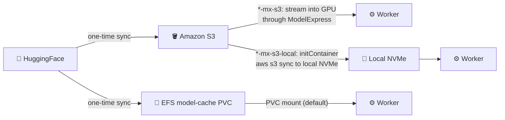
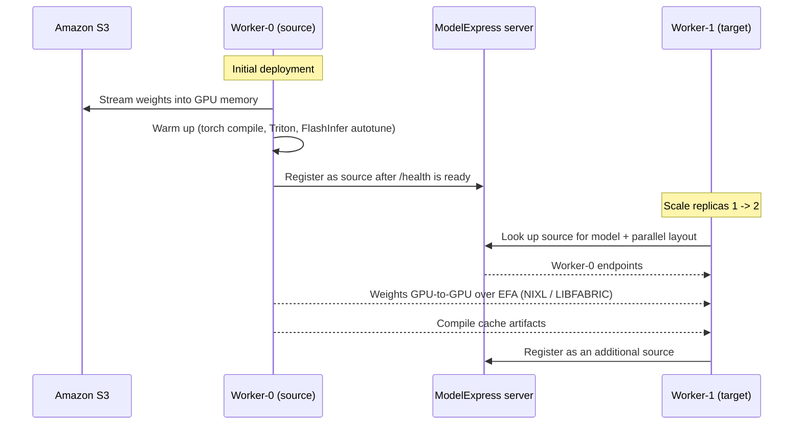
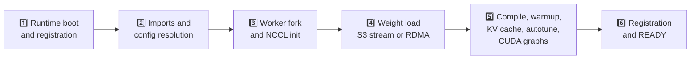

:::warning
Deployment of ML models on EKS requires access to GPUs or Neuron instances. If your deployment isn't working, it’s often due to missing access to these resources. Also, some deployment patterns rely on Karpenter autoscaling and static node groups; if nodes aren't initializing, check the logs for Karpenter or Node groups to resolve the issue.
:::

import Tabs from '@theme/Tabs';
import TabItem from '@theme/TabItem';
import CodeBlock from '@theme/CodeBlock';
import Admonition from '@theme/Admonition';
import StatusGrid from '@site/src/components/StatusGrid';
import SectionDivider from '@site/src/components/SectionDivider';
import ProgressSteps from '@site/src/components/ProgressSteps';

# NVIDIA Dynamo on Amazon EKS

<details>
<summary><strong>🚀 TL;DR – Serve LLMs with NVIDIA Dynamo on EKS</strong></summary>

**[NVIDIA Dynamo](https://github.com/ai-dynamo/dynamo) is an open-source inference stack that sits above inference engines such as vLLM.** It adds an OpenAI-compatible frontend, KV-aware routing, and disaggregated prefill/decode serving on top of the engine. This blueprint deploys the full Dynamo platform on Amazon EKS and ships ready-to-run model recipes.

### What You Get

- **☸️ A complete platform** – EKS cluster, Dynamo operator, Grove, KAI scheduler, NVIDIA GPU Operator, EFA device plugin, EFS CSI driver, and Prometheus, all delivered as ArgoCD applications
- **📦 Model weight caching** – Sync weights once from HuggingFace to Amazon S3 or to a shared EFS PVC, so replicas never download from HuggingFace at startup
- **⚡ Fast scale-out with ModelExpress** – New replicas copy weights and compile caches GPU-to-GPU over EFA from a running worker instead of reloading from S3
- **🔀 Aggregated and disaggregated serving** – Run prefill and decode in one worker, or split them across nodes with the KV cache moved over NIXL/EFA
- **🧾 Model recipes** – Tested `DynamoGraphDeployment` manifests per model and instance type, from a single `g6e` GPU up to `p6-b300.48xlarge`

The workflow has three phases:

1. **Deploy infrastructure** – provision the EKS cluster and platform add-ons with Terraform.
2. **Prepare the environment** – configure `kubectl`, wait for the platform to converge, and create the ServiceAccounts, secrets, and storage the recipes depend on.
3. **Run a recipe** – sync a model's weights and deploy it.

**Key Implementation Details:**

<StatusGrid badges={[
  {
    type: 'production',
    icon: '☸️',
    title: 'EKS Control Plane',
    value: 'v1.36',
    note: 'Default, overridable in tfvars'
  },
  {
    type: 'info',
    icon: '🌎',
    title: 'Default Region',
    value: 'us-west-2',
    note: 'Set via tfvars or AWS_REGION'
  },
  {
    type: 'production',
    icon: '🧩',
    title: 'Namespace',
    value: 'dynamo-system',
    note: 'Platform and recipes'
  },
  {
    type: 'production',
    icon: '🔁',
    title: 'Add-on Delivery',
    value: 'ArgoCD',
    note: 'GitOps-managed platform'
  },
  {
    type: 'production',
    icon: '🖥️',
    title: 'GPU Provisioning',
    value: 'Karpenter',
    note: 'Capacity Block aware'
  },
  {
    type: 'production',
    icon: '🔗',
    title: 'Interconnect',
    value: 'EFA + NIXL',
    note: 'KV cache and P2P weights'
  },
  {
    type: 'info',
    icon: '🪣',
    title: 'Weight Storage',
    value: 'S3 or EFS',
    note: 'S3 recommended'
  },
  {
    type: 'warning',
    icon: '⏱️',
    title: 'First Deploy',
    value: '20-30 min',
    note: 'Cluster and node groups'
  }
]} />

**Jump to:** [Fit check](#when-is-dynamo-a-good-fit) · [Deploy](#prerequisites-and-platform-install) · [Blueprints](#blueprints) · [Performance](#startup-and-scale-out-performance) · [Profiler](#profiler-is-your-deployment-optimal)

</details>

<details>
<summary><strong>🖥️ Click to expand: GPU capacity requirements</strong></summary>

We recommend using [EC2 Capacity Blocks](https://docs.aws.amazon.com/AWSEC2/latest/UserGuide/ec2-capacity-blocks.html) to guarantee GPU availability (for example `p5.48xlarge` or `p6-b300.48xlarge`) for your deployment window.

<Admonition type="tip" title="Tag your Capacity Block with ai-on-eks=true">

When purchasing a Capacity Block, **tag the reservation with `ai-on-eks=true`**. Karpenter's GPU NodePool is configured to discover Capacity Blocks with this tag and launch instances into them, so your reserved capacity is used automatically when pods are scheduled.

</Admonition>

</details>

<SectionDivider icon="🧠" />

## Intro to Dynamo

:::tip New to Dynamo?
Read the next three sections (Intro, Concepts, and Fit check), then jump to [Blueprints](#blueprints).
:::

### What Dynamo is, and isn't

[NVIDIA Dynamo](https://github.com/ai-dynamo/dynamo) is an open-source, datacenter-scale inference serving framework for generative AI. It **doesn't replace the inference engine**. It orchestrates engines such as vLLM, SGLang, and TensorRT-LLM, and adds the serving features that matter once a model spans multiple GPUs and nodes.

### Why it matters at scale

Large-model serving hits the same bottlenecks again and again. Dynamo is built to address them:

| Bottleneck | What Dynamo adds |
| --- | --- |
| Prefill and decode compete for the same GPUs, so utilization drops when the traffic mix shifts | **Disaggregated serving**: prefill and decode run on separate workers that scale independently |
| Requests land on workers that don't hold their prefix, so the KV cache is recomputed | **KV-aware routing**: the frontend routes each request to the worker with the best cache overlap |
| Large models take minutes to load and warm up on every new replica | **ModelExpress**: new replicas copy weights and compile caches GPU-to-GPU from a running worker |
| Static provisioning can't follow bursty traffic | **Planner**: SLA- and load-driven autoscaling of prefill and decode workers |

### How Dynamo fits on AWS

On Amazon EKS, Dynamo runs as a Kubernetes operator. GPU nodes come from Karpenter (with Capacity Block support), the KV cache and model weights move between nodes over [Elastic Fabric Adapter (EFA)](https://aws.amazon.com/hpc/efa/), and weights are stored in Amazon S3 or Amazon EFS. For the upstream concepts, see the [Dynamo architecture overview](https://docs.nvidia.com/dynamo/dev/knowledge-base/overview).

<SectionDivider icon="🏗️" />

## Concepts and architecture

A Dynamo deployment is described by a single `DynamoGraphDeployment` (DGD) custom resource. The Dynamo operator turns it into the pods, services, and gang-scheduled groups that make up the serving graph.

### Core building blocks

| Component | Role |
| --- | --- |
| **Frontend** | OpenAI-compatible HTTP endpoint. Hosts the router (`--router-mode kv`). |
| **Router** | KV-aware routing: sends each request to the worker that already caches the longest prefix. |
| **Worker** | The inference engine (for example `VllmWorker`). In aggregated mode one worker does both prefill and decode. |
| **PrefillWorker / DecodeWorker** | In disaggregated mode, prefill and decode run as separate workers, each sized for its phase. |
| **NIXL** | NVIDIA's transfer library. Moves the KV cache from prefill to decode, and model weights between workers, over EFA using the `LIBFABRIC` backend. |
| **ModelExpress** | Optional. Tracks which workers hold a loaded model so new workers can copy weights and compile caches peer-to-peer. |
| **`DynamoGraphDeployment`** | The custom resource that declares the components, replicas, images, and placement for one serving graph. |

### Serving modes at a glance

- **Aggregated** – each worker runs the full request: prefill (processing the prompt) and decode (generating tokens). Simple to operate and a good default.
- **Disaggregated** – prefill and decode run on separate workers. Prefill is compute-bound and decode is memory-bandwidth-bound, so splitting them lets you size and scale each phase independently. The KV cache produced by prefill moves to decode over NIXL/EFA, so both workers must land in the same zone.



### Platform components

| Component | Why it's here |
| --- | --- |
| **Dynamo operator** | Reconciles `DynamoGraphDeployment` resources into pods and services. |
| **Grove** | Gang-schedules multi-pod components so a model's workers start together or not at all. |
| **KAI scheduler** | GPU-aware scheduler used by the operator for topology-aware placement. |
| **NVIDIA GPU Operator** | Installs the GPU driver stack and device plugin on GPU nodes. |
| **EFA device plugin** | Exposes `vpc.amazonaws.com/efa` interfaces to pods for RDMA. |
| **EFS CSI driver** | Provides the shared `ReadWriteMany` caches (`model-cache`, `compilation-cache`, `perf-cache`). |
| **kube-prometheus-stack** | Metrics for the frontend and workers. Also the data source for SLA-driven Planner scaling. |

### Reference architecture on EKS

The blueprint provisions the cluster with Terraform and delivers every platform add-on as an ArgoCD application. Model weights live in Amazon S3 or on a shared EFS volume, and inference pods reach S3 through a ServiceAccount mapped to an IAM role.



### Request lifecycle

In disaggregated mode a single chat request touches every component:



In aggregated mode the same worker does both steps, so there is no KV transfer.

### EFA networking on EKS

The blueprint's `blueprint.tfvars` sets a few networking options that the RDMA paths (KV transfer and P2P weight copy) depend on:

<details>
<summary>View the networking settings and why they matter</summary>

| Setting | Value | Why it matters |
| --- | --- | --- |
| `ami_family` | `al2023` | Amazon Linux 2023 GPU AMIs with EFA support. |
| `enable_aws_efa_k8s_device_plugin` | `true` | Exposes EFA interfaces as the `vpc.amazonaws.com/efa` resource that workers request. |
| `efa_network_interfaces_policy` | `"2"` | Bandwidth-optimized EFA interface layout on GPU nodes (`1` is IP-optimized, the base default). |
| `ENABLE_MULTI_NIC` | `"true"` | Lets the VPC CNI use the multiple network cards on P5 and P6 instances. |
| `ENABLE_PREFIX_DELEGATION` | `"true"` | Assigns IP prefixes instead of single IPs, so dense GPU nodes don't run out of pod IPs. |
| `MINIMUM_IP_TARGET` / `WARM_IP_TARGET` | `16` / `5` | Keeps a warm pool of IPs so pods start without waiting on the CNI. |
| `AWS_VPC_K8S_CNI_EXTERNALSNAT` | `"true"` | Leaves SNAT to the NAT gateway rather than the node. |

Workers request EFA interfaces explicitly. The recipes use 16 per worker on `p5.48xlarge` and `p6-b300.48xlarge`, and 4 on `g7e.48xlarge`.

</details>

### Three ways to load weights

Recipes never download from HuggingFace at serving time. The manifest you pick decides how the worker gets its weights:



| Path | Manifests | Load speed | Cost | Setup |
| --- | --- | --- | --- | --- |
| **S3 streaming with ModelExpress** (recommended) | `*-mx-s3` | Fast. Weights stream straight into GPU memory. | Lowest. S3 storage only. | IAM-mapped inference ServiceAccount |
| **S3 to local NVMe** | `*-mx-s3-local` | Fast. An initContainer runs `aws s3 sync` with the CRT client to a hostPath under `/mnt/k8s-disks/0`, then the worker loads from local disk. | S3 storage plus local instance storage | Same as S3, plus an instance with local NVMe |
| **EFS PVC** | `h100-agg`, `h100-disagg` | Slower. Shared EFS throughput limits load time. | EFS storage | No S3 client or IAM setup. Weights appear as a filesystem path. |

<SectionDivider icon="✅" />

## When is Dynamo a good fit?

<Tabs groupId="fit-check">
<TabItem value="good" label="✅ Good fit" default>

- **Large or MoE models** that need multiple GPUs or nodes, such as GLM-5.3 or Nemotron-3-Ultra 550B.
- **High concurrency or long context**, where prefill dominates GPU time and benefits from its own workers.
- **Strict latency SLAs** on time to first token (TTFT) and inter-token latency (ITL).
- **The customer wants to own the stack** on EKS: their VPC, their GPUs (often Capacity Blocks), their images, and their observability.

</TabItem>
<TabItem value="not" label="⚠️ Probably not the right fit">

- **A small model on one GPU at low request rates.** A single vLLM deployment is simpler and costs the same.
- **No Kubernetes skills on the team.** Dynamo adds an operator, CRDs, gang scheduling, and RDMA networking to run and debug.
- **The customer wants fully managed inference.** Point them to [Amazon Bedrock](https://aws.amazon.com/bedrock/) (including Custom Model Import) or [Amazon SageMaker AI](https://aws.amazon.com/sagemaker/ai/) inference endpoints instead.

</TabItem>
<TabItem value="compare" label="⚖️ Compare">

| | Dynamo on EKS | Plain vLLM on EKS | Managed (Bedrock, SageMaker AI) |
| --- | --- | --- | --- |
| **Operational effort** | High: operator, CRDs, EFA, gang scheduling | Medium: Deployments and Services | Low: AWS runs the serving stack |
| **Performance tuning** | Full: disaggregation, KV-aware routing, per-phase parallelism | Engine flags only | Limited to the service's options |
| **Scale** | Multi-node, independently scaled prefill and decode | Per-replica scale-out | Service-managed |
| **Cost control** | Full: Capacity Blocks, right-sized P/D ratio, P2P scale-out | Good | Pay per token or per instance |

</TabItem>
</Tabs>

:::info Questions to ask the customer
- **Model:** which model and size? Dense or MoE? Is it already on HuggingFace?
- **Traffic shape:** typical input and output lengths (ISL/OSL), peak concurrency, and how bursty it is.
- **SLAs:** TTFT and ITL targets, or an end-to-end latency target.
- **GPU access:** existing quota or Capacity Blocks, and in which Region and instance family.
- **Team skills:** who will run Kubernetes, EFA networking, and GPU troubleshooting day to day?
:::

<SectionDivider icon="🚀" />

## Prerequisites and platform install

:::info Deployment steps are collapsed
The full step-by-step deployment guide is inside the expandable section below. **Click it to open** the prerequisites, the install steps, and the environment preparation.
:::

<details>
<summary><strong>▶️ Click to expand: step-by-step deployment instructions</strong> (provision an Amazon EKS cluster with the NVIDIA Dynamo platform and prepare it for model recipes)</summary>

<ProgressSteps
  steps={[
    { title: "Prerequisites", description: "Install required tools" },
    { title: "Deploy", description: "Provision EKS and the Dynamo platform" },
    { title: "Prepare", description: "Configure access, secrets, and storage" },
    { title: "Cache weights", description: "Sync model weights once" }
  ]}
  currentStep={0}
/>

### Prerequisites

- **GPU capacity** – service quota or an [EC2 Capacity Block](https://docs.aws.amazon.com/AWSEC2/latest/UserGuide/ec2-capacity-blocks.html) for the instance family your recipe uses (`g6e`, `g7e`, `p5`, or `p6-b300`).
- **[AWS CLI](https://aws.amazon.com/cli/)** - AWS Command Line Interface
- **[kubectl](https://kubernetes.io/docs/tasks/tools/)** - Kubernetes command-line tool
- **[terraform](https://developer.hashicorp.com/terraform/install)** - Infrastructure as Code tool
- **[helm](https://helm.sh/docs/intro/install/)** - used to run the model sync jobs
- **[jq](https://jqlang.github.io/jq/)** and **envsubst** (from `gettext`) - used to read Terraform outputs and render manifests
- A **[HuggingFace token](https://huggingface.co/settings/tokens)** - required for gated models and higher rate limits

### Deploy

#### 1. Clone the repository

```bash title="Clone the repository"
git clone https://github.com/awslabs/ai-on-eks.git
cd ai-on-eks/blueprints/inference/nvidia-dynamo
```

:::info Working Directory
All commands below run from `blueprints/inference/nvidia-dynamo`. Paths to the Terraform stack (`../../../infra/nvidia-dynamo`) are resolved from there. Recipe commands are the exception: they run from each recipe's own folder.
:::

:::info Authentication Profile
If you are using a profile for authentication, set `export AWS_PROFILE="<PROFILE_name>"` to the desired profile name.
:::

#### 2. Review and customize the configuration

Switch into the Terraform stack:

```bash
pushd ../../../infra/nvidia-dynamo
```

Edit [`terraform/blueprint.tfvars`](https://github.com/awslabs/ai-on-eks/blob/main/infra/nvidia-dynamo/terraform/blueprint.tfvars) to match your environment. The most common changes are the AWS region and the EKS control plane version. The Dynamo-specific add-ons and the EFA networking settings are already set:

<CodeBlock language="hcl" title="infra/nvidia-dynamo/terraform/blueprint.tfvars" showLineNumbers>
{require('!!raw-loader!@site/../infra/nvidia-dynamo/terraform/blueprint.tfvars').default}
</CodeBlock>

You can control the deployment region in either of these ways:

- Edit `blueprint.tfvars` and set the `region` variable.
- Set the `AWS_REGION=<AWS_REGION>` environment variable.

> Default AWS region is `us-west-2`.

<ProgressSteps
  steps={[
    { title: "Prerequisites", description: "Install required tools" },
    { title: "Deploy", description: "Provision EKS and the Dynamo platform" },
    { title: "Prepare", description: "Configure access, secrets, and storage" },
    { title: "Cache weights", description: "Sync model weights once" }
  ]}
  currentStep={1}
/>

#### 3. Run the installer

```bash title="Deploy the NVIDIA Dynamo platform"
./install.sh
```

The script copies the shared Terraform base into a local `_LOCAL` workspace, bootstraps the backend, and runs `terraform apply`. It creates:

- The Amazon EKS cluster and the `dynamo-system` namespace
- An S3 bucket for model weights
- IAM roles for model sync (write) and inference (read)
- EFS storage for shared caches
- ArgoCD applications that install the platform and its dependencies

This step can take 20-30 minutes on a first run while the cluster and node groups come up. Once the apply completes, return to the blueprint directory:

```bash
popd
```

<ProgressSteps
  steps={[
    { title: "Prerequisites", description: "Install required tools" },
    { title: "Deploy", description: "Provision EKS and the Dynamo platform" },
    { title: "Prepare", description: "Configure access, secrets, and storage" },
    { title: "Cache weights", description: "Sync model weights once" }
  ]}
  currentStep={2}
/>

### Prepare the Environment

**Step 1: Configure kubectl access**

The Terraform stack exposes a ready-made `aws eks update-kubeconfig` command as the `configure_kubectl` output:

```bash
eval $(terraform -chdir="../../../infra/nvidia-dynamo/terraform/_LOCAL" output -raw configure_kubectl)
```

**Step 2: Wait for the ArgoCD applications to be healthy**

The platform add-ons (CSI drivers, GPU Operator, Dynamo operator, KAI scheduler, Grove, and so on) are ArgoCD applications. Wait for every application to report `Healthy` before continuing. Otherwise later steps can fail because a dependency, such as the EFS CSI driver or the Dynamo CRDs, isn't ready yet. This waits up to 10 minutes:

```bash
kubectl wait --for=jsonpath='{.status.health.status}'=Healthy \
  applications.argoproj.io --all \
  -n argocd \
  --timeout=600s
```

**Step 3: Set environment variables**

Read the S3 bucket name and the two ServiceAccount names from the Terraform outputs. The recipes reference `$S3_BUCKET`, `$MODEL_SYNC_SA`, and `$INFERENCE_SA` directly, so export them in the shell you'll run the recipes from:

```bash
eval "$(
  terraform -chdir="../../../infra/nvidia-dynamo/terraform/_LOCAL" output -json | jq -r '
    "export S3_BUCKET=" + (.s3_models_buckets_name.value[0]),
    "export MODEL_SYNC_SA=" + (.s3_models_sync_sa.value),
    "export INFERENCE_SA=" + (.s3_models_inference_sa.value)
  '
)"
```

| Variable | Purpose |
| --- | --- |
| `S3_BUCKET` | The bucket where model weights are stored. |
| `MODEL_SYNC_SA` | ServiceAccount used by the sync Job to **write** weights to S3. |
| `INFERENCE_SA` | ServiceAccount used by inference pods to **read** weights from S3. |

**Step 4: Create the ServiceAccounts**

Terraform maps each name to an IAM role (via IRSA or EKS Pod Identity): the sync SA gets write access to the bucket and the inference SA gets read access. Keeping them separate holds a least-privilege boundary between syncing and serving.

```bash
kubectl -n dynamo-system create sa $MODEL_SYNC_SA
kubectl -n dynamo-system create sa $INFERENCE_SA
```

**Step 5: Create the HuggingFace token secret**

The download and sync Jobs read this secret to authenticate with HuggingFace:

```bash
export HF_TOKEN=<HF TOKEN>
kubectl -n dynamo-system create secret generic hf-token-secret \
  --from-literal=HF_TOKEN=${HF_TOKEN}
```

**Step 6: Create the EFS PersistentVolumeClaims**

Create the shared EFS-backed caches. All three use the `efs-sc-dynamic` storage class with `ReadWriteMany` access so they can be shared across pods:

| PVC | Purpose |
| --- | --- |
| `model-cache` | Model weights for the PVC-based caching workflow. |
| `compilation-cache` | Compiled kernels and engines, so replicas don't recompile on every start. |
| `perf-cache` | Performance-tuning and benchmark artifacts. |

<details>
<summary>View <code>pvc-efs.yaml</code></summary>

<CodeBlock language="yaml" title="pvc-efs.yaml" showLineNumbers>
{require('!!raw-loader!@site/../blueprints/inference/nvidia-dynamo/pvc-efs.yaml').default}
</CodeBlock>

</details>

```bash
kubectl -n dynamo-system apply -f pvc-efs.yaml
```

**Step 7: Verify**

```bash
kubectl get applications.argoproj.io -n argocd
kubectl -n dynamo-system get sa,secret,pvc
```

**Expected output:** every ArgoCD application is `Synced` and `Healthy`, both ServiceAccounts and `hf-token-secret` exist, and the three PVCs are `Bound`.

<ProgressSteps
  steps={[
    { title: "Prerequisites", description: "Install required tools" },
    { title: "Deploy", description: "Provision EKS and the Dynamo platform" },
    { title: "Prepare", description: "Configure access, secrets, and storage" },
    { title: "Cache weights", description: "Sync model weights once" }
  ]}
  currentStep={3}
/>

</details>

### Model weight caching

Sync weights once to one of two targets. The recipe manifest you choose decides which one it reads from (see [Three ways to load weights](#three-ways-to-load-weights)).

<Tabs groupId="model-cache">
<TabItem value="s3" label="🪣 Amazon S3 (recommended)" default>

Syncs the model repository to your S3 bucket with the [AI on EKS inference-charts](https://github.com/awslabs/ai-on-eks-charts/tree/main/charts/inference-charts) Helm chart. The chart's `s3ModelCopy` component runs a one-shot Job on an NVMe-equipped, high-bandwidth node and downloads files in parallel. Weights land under `s3://$S3_BUCKET/$MODEL_NAME/`.

**Best for:** durable storage shared across clusters, regions, or accounts, and the most cost-effective option.

```bash
helm repo add ai-on-eks https://awslabs.github.io/ai-on-eks-charts/
helm repo update
```

```bash title="Sync a model to S3"
export MODEL_NAME=<MODEL NAME>   # e.g. Qwen/Qwen3-32B
helm -n dynamo-system install hf-s3-sync-model ai-on-eks/inference-charts -f - <<EOF
s3ModelCopy:
  namespace: dynamo-system
  model: $MODEL_NAME
  s3Bucket: $S3_BUCKET
  hfTokenSecret:
    name: "hf-token-secret"
    envFrom: true
  serviceAccountName: $MODEL_SYNC_SA
  requireLocalNvme: true
  storageSize: 100
  requireNetworkBandwidth: 25000
  parameters:
    fileWorkers: 18
EOF
```

| Value | Meaning |
| --- | --- |
| `serviceAccountName` | The sync ServiceAccount, mapped to an IAM role with write access to the bucket. |
| `requireLocalNvme` / `requireNetworkBandwidth` | Place the Job on an NVMe-backed node with the given network bandwidth in Mbps (25000 = 25 Gbps). |
| `parameters.fileWorkers` | Files downloaded in parallel. |
| `storageSize` | Scratch volume in GiB. Size it as roughly **the largest file in the repo × `fileWorkers`**. |

**Tuned values and measured sync times per model:**

| Model | Safetensors files | `fileWorkers` | `storageSize` | `requireNetworkBandwidth` | Measured sync |
| --- | --- | --- | --- | --- | --- |
| Nemotron-3.5-Bolt-E4B | 1 × ~16 GB | 2 | 50 GiB | 5000 | 28 s |
| Qwen3-32B | 18 × ~4 GB | 18 | 100 GiB | 25000 | 54 s |
| GLM-5.3-Flash | 62 × ~5.4 GB | 30 | 200 GiB | 25000 | 184 s |
| GLM-5.3 | 141 × ~5.5 GB | 30 | 200 GiB | 25000 | 413 s |
| Nemotron-3-Ultra 550B | 225 × ~5 GB | 35 | 200 GiB | 25000 | 650 s |

**Monitor and clean up:**

```bash
kubectl -n dynamo-system wait --for=condition=ready pod \
  -l app.kubernetes.io/name=s3-model-copy,app.kubernetes.io/instance=hf-s3-sync-model --timeout=600s
kubectl -n dynamo-system logs -f \
  -l app.kubernetes.io/name=s3-model-copy,app.kubernetes.io/instance=hf-s3-sync-model
kubectl -n dynamo-system get job -l app.kubernetes.io/instance=hf-s3-sync-model
aws s3 ls "s3://$S3_BUCKET/$MODEL_NAME/" --recursive --human-readable --summarize

helm -n dynamo-system uninstall hf-s3-sync-model
```

:::caution Sync pod stuck in Pending?
Karpenter can't find a node that satisfies the NVMe and bandwidth constraints. Check the pod's `FailedScheduling` events and the Karpenter controller logs. The usual causes are:

- **Instance types not offered** in your Region or in the AZs your subnets span.
- **Insufficient EC2 vCPU quota** for the matching On-Demand or Spot instance family.
- **NodePool requirements exclude matching instances** (instance family, size, capacity type, or AZ).

If no matching instances are available to you, relax the constraints in this order: lower `requireNetworkBandwidth` first, then `storageSize` and `fileWorkers` together.
:::

</TabItem>
<TabItem value="pvc" label="📁 EFS PVC">

Runs a Job that pulls the model repository from HuggingFace into the shared `model-cache` PVC, with `HF_HUB_ENABLE_HF_TRANSFER=1` and `HF_XET_HIGH_PERFORMANCE=1` for faster downloads.

**Best for:** the simplest consumption path. Weights appear as a shared filesystem path with no S3 client or IAM setup. The tradeoff is throughput: shared EFS storage is easy to mount `ReadWriteMany` but can load models more slowly than S3 streaming.

<details>
<summary>View <code>model-download.yaml</code></summary>

<CodeBlock language="yaml" title="model-cache/model-download.yaml" showLineNumbers>
{require('!!raw-loader!@site/../blueprints/inference/nvidia-dynamo/model-cache/model-download.yaml').default}
</CodeBlock>

</details>

```bash title="Sync a model to the model-cache PVC"
export MODEL_NAME=<MODEL NAME>   # e.g. Qwen/Qwen3-32B
envsubst '${MODEL_NAME}' < model-cache/model-download.yaml | kubectl apply -n dynamo-system -f -
```

**Monitor and clean up:**

```bash
kubectl -n dynamo-system wait --for=condition=ready pod --selector=job-name=model-download --timeout=600s
kubectl -n dynamo-system logs -l app=model-download -f
kubectl -n dynamo-system get job/model-download

kubectl -n dynamo-system delete job/model-download   # weights stay on the PVC
```

</TabItem>
</Tabs>

### NVIDIA ModelExpress (optional)

[ModelExpress](https://github.com/ai-dynamo/modelexpress) speeds up model distribution. It tracks model metadata and cache entries in-cluster and lets pods transfer weights peer-to-peer. Recipes with `mx` in the manifest name use it. Install its CRDs and RBAC once per cluster.

<Tabs groupId="modelexpress-setup">
<TabItem value="crds" label="1️⃣ CRDs" default>

Creates the `modelmetadatas.modelexpress.nvidia.com` and `modelcacheentries.modelexpress.nvidia.com` CRDs:

```bash
kubectl apply -f https://raw.githubusercontent.com/ai-dynamo/modelexpress/refs/heads/main/examples/crds.yaml
```

</TabItem>
<TabItem value="rbac" label="2️⃣ ServiceAccount and RBAC">

Creates the `modelexpress` ServiceAccount, `Role`, `RoleBinding`, and `ClusterRole`:

```bash
kubectl -n dynamo-system apply -f \
 https://raw.githubusercontent.com/ai-dynamo/modelexpress/refs/heads/main/examples/dynamo_p2p_transfer_k8s/vllm/rbac-modelmetadata.yaml
```

</TabItem>
</Tabs>

<details>
<summary><strong>How P2P weight transfer works</strong></summary>

The first worker does a cold start: it streams weights from S3 into GPU memory, runs the full warm-up (torch compile, Triton kernels, FlashInfer autotuning), and only registers as a **source** once its health endpoint reports ready. When you scale out, new workers find that source through the ModelExpress server and copy weights GPU-to-GPU over EFA, plus the compile caches, so they skip most of the warm-up.



A target only pairs with a source that serves the same model with the same parallel layout, and each GPU rank copies from the matching rank. Workers use a required `podAffinity` on zone so the RDMA transfer stays on the EFA fabric.

</details>

<SectionDivider icon="🧾" />

## Blueprints

### Choosing a serving mode

- **Aggregated:** every worker runs the whole request, prefill and decode, behind one frontend. You scale by adding identical workers.
- **Disaggregated:** prefill and decode run on separate workers sized for their phase. The KV cache moves from prefill to decode over NIXL/EFA, and you scale each pool on its own.

| Signal | Recommended mode |
| --- | --- |
| Getting started, or a new model on a new instance type | Aggregated |
| Short prompts, chat-style traffic, moderate concurrency | Aggregated |
| Model fits on one node and the team wants the simplest operations | Aggregated |
| Long prompts (RAG, document or code context) where prefill dominates GPU time | Disaggregated |
| TTFT suffers under load while decode GPUs sit idle, or the reverse | Disaggregated |
| You need to scale prompt processing and token generation independently | Disaggregated |
| Very long context (for example the 1M-token window on Nemotron-3-Ultra) | Disaggregated |

:::tip
Start with aggregated. Move to disaggregated when [profiling](#profiler-is-your-deployment-optimal) shows a prefill bottleneck.
:::

Each model lives under [`recipes/`](https://github.com/awslabs/ai-on-eks/tree/main/blueprints/inference/nvidia-dynamo/recipes). Recipe commands use paths relative to the recipe folder, so switch into it first:

```bash
pushd recipes/<recipe>
# ...run the recipe commands...
popd
```

### Aggregated serving

#### What it is

One worker handles both prefill and decode. A deployment is a frontend plus N identical workers, and the frontend's KV-aware router spreads requests across them.

#### When to use it

It's the default and the simplest to run. Use it to bring up a new model, for chat-style traffic, and whenever the model fits on one node.

#### What you need

The base cluster from [Prerequisites and platform install](#prerequisites-and-platform-install), with no extra system configuration. Recipes with `mx` in the name also need [ModelExpress](#nvidia-modelexpress-optional) installed.

#### Example recipes

| Size | Model | Instance | Manifests |
| --- | --- | --- | --- |
| Small | [Nemotron-3.5-Bolt-E4B](https://github.com/awslabs/ai-on-eks/tree/main/blueprints/inference/nvidia-dynamo/recipes/nemotron-3.5-bolt-e4b) | `g6e`, 1 GPU (TP1) | `g6e-agg-s3` |
| Medium | [Qwen3-32B](https://github.com/awslabs/ai-on-eks/tree/main/blueprints/inference/nvidia-dynamo/recipes/qwen3-32b) | `p5.48xlarge` H100, TP4 | `h100-agg`, `h100-agg-mx-s3` |
| Medium | [GLM-5.3-Flash](https://github.com/awslabs/ai-on-eks/tree/main/blueprints/inference/nvidia-dynamo/recipes/glm-5.3-flash) | `g7e.48xlarge`, TP8 | `g7e-agg-mx-s3`, `g7e-agg-mx-s3-local` |
| Large | [GLM-5.3](https://github.com/awslabs/ai-on-eks/tree/main/blueprints/inference/nvidia-dynamo/recipes/glm-5.3) | `p6-b300.48xlarge` B300, TP8 | `b300-agg-mx-s3`, `b300-agg-mx-s3-local` |

:::note Reading manifest names
Names encode **instance – topology – ModelExpress – weight source**. For example `h100-agg-mx-s3` is aggregated serving on H100 that streams weights from S3 through ModelExpress, `b300-agg-mx-s3-local` copies the weights from S3 to local NVMe first, and `h100-agg` with no source suffix reads from the `model-cache` PVC.
:::

#### Walkthrough: Qwen3-32B (aggregated, S3 + ModelExpress)

This example deploys Qwen3-32B with TP=4 on a `p5.48xlarge` with a 128K context window (YaRN rope scaling), loading weights from S3 through ModelExpress. It assumes you [synced the weights to S3](#model-weight-caching) with `MODEL_NAME="Qwen/Qwen3-32B"` and installed [ModelExpress](#nvidia-modelexpress-optional).

<Tabs groupId="agg-walkthrough">
<TabItem value="deploy" label="1️⃣ Deploy" default>

```bash title="Deploy Qwen3-32B (aggregated, S3 + ModelExpress)"
cd recipes/qwen3-32b
envsubst '${S3_BUCKET} ${INFERENCE_SA}' < vllm/h100-agg-mx-s3.yaml | kubectl apply -n dynamo-system -f -

kubectl -n dynamo-system logs \
  -l nvidia.com/dynamo-graph-deployment-name=qwen3-32b-h100-agg-mx-s3-vllm \
  --all-containers=true --max-log-requests=20 --prefix=true --timestamps -f
```

The deployment starts three components:

| Component | Role |
| --- | --- |
| `Frontend` | OpenAI-compatible HTTP endpoint with KV-aware routing across workers. |
| `ModelExpress` | Tracks which workers hold the loaded model. Uses Kubernetes as its metadata backend, so no Redis is needed. |
| `VllmWorker` | vLLM engine with TP=4 on one `p5.48xlarge`, loading weights with `--load-format modelexpress`. |

The first worker does a cold start: it streams weights from S3 into GPU memory, runs the full warm-up, and registers as a ModelExpress **source** once `/health` reports ready.

</TabItem>
<TabItem value="manifest" label="📄 Manifest">

<CodeBlock language="yaml" title="recipes/qwen3-32b/vllm/h100-agg-mx-s3.yaml" showLineNumbers>
{require('!!raw-loader!@site/../blueprints/inference/nvidia-dynamo/recipes/qwen3-32b/vllm/h100-agg-mx-s3.yaml').default}
</CodeBlock>

</TabItem>
<TabItem value="test" label="2️⃣ Smoke Test">

Wait for the workers to become ready, then port-forward the frontend:

```bash
export GRAPH=qwen3-32b-h100-agg-mx-s3-vllm

kubectl -n dynamo-system wait pod \
  -l nvidia.com/dynamo-graph-deployment-name=${GRAPH} \
  --for=condition=Ready --timeout=30m

kubectl -n dynamo-system port-forward svc/${GRAPH}-frontend 8000:8000
```

In a second terminal:

```bash
curl -s localhost:8000/v1/models | jq

curl -s localhost:8000/v1/chat/completions \
  -H "Content-Type: application/json" \
  -d '{
    "model": "Qwen/Qwen3-32B",
    "messages": [
      {"role": "user", "content": "Explain what Kubernetes is in two sentences."}
    ],
    "max_tokens": 1024,
    "stream": false
  }' | jq
```

A successful response returns the answer in `choices[0].message.content`. Qwen3 thinks by default and these manifests don't set a reasoning parser, so the `<think>` block appears inside `content`.

</TabItem>
<TabItem value="scale" label="3️⃣ Scale Out">

Scale `VllmWorker` (index `2` in `spec.components`) from 1 to 2 replicas. The `test` op makes the patch fail if that index points to a different component:

```bash
kubectl patch dynamographdeployment qwen3-32b-h100-agg-mx-s3-vllm \
  -n dynamo-system \
  --type='json' \
  -p='[
    {"op": "test", "path": "/spec/components/2/name", "value": "VllmWorker"},
    {"op": "replace", "path": "/spec/components/2/replicas", "value": 2}
  ]'
```

The new worker copies weights and compile caches from the first one over EFA instead of streaming from S3. Compare how long the `main` container takes from start to Ready on each pod. This leaves out scheduling, node provisioning, and image pull:

```bash
kubectl -n dynamo-system get pods \
  -l nvidia.com/dynamo-graph-deployment-name=qwen3-32b-h100-agg-mx-s3-vllm,nvidia.com/dynamo-component=VllmWorker \
  -o json | jq -r '
    ["POD", "MAIN_STARTED", "MAIN_READY", "ELAPSED"],
    (.items[]
      | (.status.containerStatuses[] | select(.name == "main") | .state.running.startedAt) as $start
      | (.status.conditions[] | select(.type == "ContainersReady") | .lastTransitionTime) as $ready
      | [.metadata.name, $start, $ready, "\(($ready | fromdateiso8601) - ($start | fromdateiso8601))s"])
    | @tsv' | column -t
```

Once both are Ready, the Frontend routes across them with KV-aware routing, so the smoke test works unchanged.

</TabItem>
<TabItem value="glm-logs" label="🔍 GLM-5.3: source vs target logs">

The same scale-out works for the larger [GLM-5.3 recipe](https://github.com/awslabs/ai-on-eks/tree/main/blueprints/inference/nvidia-dynamo/recipes/glm-5.3) on `p6-b300.48xlarge`. Its manifest uses a custom image, so set `IMAGE` first:

```bash
cd recipes/glm-5.3
export IMAGE="public.ecr.aws/ai-on-eks/ai-dynamo/vllm-runtime:1.7.0-27f6052cd5-mx0.8.0-6b7d4188-efa"
envsubst '${IMAGE} ${S3_BUCKET} ${INFERENCE_SA}' < vllm/b300-agg-mx-s3.yaml | kubectl apply -n dynamo-system -f -
```

After you scale `VllmWorker` to 2 replicas, watch both workers side by side. The `grove.io/podclique-pod-index` label tells them apart: index `0` is the original worker (source), and index `1` is the new one (target):

```bash
# Source: the original worker, loaded from S3
kubectl -n dynamo-system logs -l nvidia.com/dynamo-graph-deployment-name=glm53-b300-agg-mx-s3-vllm,nvidia.com/dynamo-component=VllmWorker,grove.io/podclique-pod-index=0 --all-containers=true --max-log-requests=20 --prefix=true --timestamps -f

# Target: the new worker, receiving weights over RDMA
kubectl -n dynamo-system logs -l nvidia.com/dynamo-graph-deployment-name=glm53-b300-agg-mx-s3-vllm,nvidia.com/dynamo-component=VllmWorker,grove.io/podclique-pod-index=1 --all-containers=true --max-log-requests=20 --prefix=true --timestamps -f
```

In the target's logs, the S3 streaming step is replaced by a NIXL transfer from the source, and the compile cache is installed before engine start-up.

</TabItem>
<TabItem value="remove" label="🧹 Remove">

```bash
envsubst '${S3_BUCKET} ${INFERENCE_SA}' < vllm/h100-agg-mx-s3.yaml | kubectl delete -n dynamo-system -f -
```

</TabItem>
</Tabs>

### Disaggregated serving

:::tip
Start with aggregated. Move to disaggregated when [profiling](#profiler-is-your-deployment-optimal) shows a prefill bottleneck.
:::

#### What it is

Separate `PrefillWorker` and `DecodeWorker` components. The prefill worker processes the prompt and produces the KV cache, which is transferred to the decode worker over NIXL. The decode worker then generates tokens.

#### When to use it

Long prompts, prefill-heavy traffic, and cases where you need to scale prompt processing and token generation independently.

#### What changes at the system level

| Area | Change from aggregated |
| --- | --- |
| **Networking** | EFA-enabled nodes. Workers request 16 EFA interfaces each on `p5.48xlarge` and `p6-b300.48xlarge`. |
| **Placement** | Prefill and decode workers must land in the same AZ (required zone `podAffinity`). |
| **KV transfer** | `--kv-transfer-config` with `NixlConnector` and the `LIBFABRIC` backend. |
| **Runtime image** | The EFA build of the vLLM runtime (`vllm-runtime:1.6.2-efa`). |
| **Routing** | The KV-aware router tracks prefill-side cache state from the workers' KV events (`--kv-events-config`), so a prompt goes to the prefill worker that already holds its prefix. |
| **Sizing** | You choose a prefill-to-decode worker ratio. The recipes start at 1P + 1D. |

#### Example recipes

| Size | Model | Instance | Manifest | Storage |
| --- | --- | --- | --- | --- |
| Medium | [Qwen3-32B](https://github.com/awslabs/ai-on-eks/tree/main/blueprints/inference/nvidia-dynamo/recipes/qwen3-32b) | 1P + 1D × `p5.48xlarge` H100, TP4 each | `h100-disagg` | EFS PVC |
| Large | [Nemotron-3-Ultra 550B](https://github.com/awslabs/ai-on-eks/tree/main/blueprints/inference/nvidia-dynamo/recipes/nemotron-3-ultra) | 1P + 1D × `p6-b300.48xlarge` B300, TP8 each | `b300-disagg-mx-s3` | S3 + ModelExpress |

#### Walkthrough 1: Qwen3-32B, the delta from aggregated

The same model as the aggregated walkthrough, split into a `PrefillWorker` and a `DecodeWorker`, each on its own `p5.48xlarge` with TP=4. Weights come from the `model-cache` PVC, so [sync them to the PVC](#model-weight-caching) first with `MODEL_NAME="Qwen/Qwen3-32B"`.

<Tabs groupId="disagg-walkthrough-qwen">
<TabItem value="deploy" label="1️⃣ Deploy" default>

```bash title="Deploy Qwen3-32B (disaggregated, PVC)"
cd recipes/qwen3-32b
kubectl apply -n dynamo-system -f vllm/h100-disagg.yaml

kubectl -n dynamo-system logs \
  -l nvidia.com/dynamo-graph-deployment-name=qwen3-32b-h100-disagg-vllm \
  --all-containers=true --max-log-requests=20 --prefix=true --timestamps -f
```

</TabItem>
<TabItem value="manifest" label="📄 Manifest">

<CodeBlock language="yaml" title="recipes/qwen3-32b/vllm/h100-disagg.yaml" showLineNumbers>
{require('!!raw-loader!@site/../blueprints/inference/nvidia-dynamo/recipes/qwen3-32b/vllm/h100-disagg.yaml').default}
</CodeBlock>

</TabItem>
<TabItem value="verify" label="🔗 Verify KV transfer">

Confirm both workers are running in the same zone:

```bash
kubectl -n dynamo-system get pods \
  -l nvidia.com/dynamo-graph-deployment-name=qwen3-32b-h100-disagg-vllm \
  -o custom-columns='POD:.metadata.name,COMPONENT:.metadata.labels.nvidia\.com/dynamo-component,NODE:.spec.nodeName'

kubectl get nodes -L topology.kubernetes.io/zone,node.kubernetes.io/instance-type
```

Then follow each worker's logs while you send a request. The prefill worker processes the prompt and the decode worker generates the tokens. Both log their NIXL setup with the `LIBFABRIC` backend at startup:

```bash
kubectl -n dynamo-system logs -f \
  -l nvidia.com/dynamo-graph-deployment-name=qwen3-32b-h100-disagg-vllm,nvidia.com/dynamo-component=PrefillWorker --prefix=true

kubectl -n dynamo-system logs -f \
  -l nvidia.com/dynamo-graph-deployment-name=qwen3-32b-h100-disagg-vllm,nvidia.com/dynamo-component=DecodeWorker --prefix=true
```

</TabItem>
<TabItem value="test" label="2️⃣ Smoke Test">

```bash
export GRAPH=qwen3-32b-h100-disagg-vllm

kubectl -n dynamo-system wait pod \
  -l nvidia.com/dynamo-graph-deployment-name=${GRAPH} \
  --for=condition=Ready --timeout=30m

kubectl -n dynamo-system port-forward svc/${GRAPH}-frontend 8000:8000
```

In a second terminal, send the same request as the aggregated walkthrough:

```bash
curl -s localhost:8000/v1/chat/completions \
  -H "Content-Type: application/json" \
  -d '{
    "model": "Qwen/Qwen3-32B",
    "messages": [
      {"role": "user", "content": "Explain what Kubernetes is in two sentences."}
    ],
    "max_tokens": 1024,
    "stream": false
  }' | jq
```

</TabItem>
<TabItem value="remove" label="🧹 Remove">

```bash
kubectl delete -n dynamo-system -f vllm/h100-disagg.yaml
```

</TabItem>
</Tabs>

#### Walkthrough 2: Nemotron-3-Ultra 550B at production scale

Nemotron-3-Ultra is the large-model disaggregated case. Each worker runs TP=8 on its own `p6-b300.48xlarge` with 8 GPUs and 16 EFA interfaces. The manifest serves a **1M-token context window** with an FP8 KV cache, streams weights from S3 through ModelExpress, and enables the `nemotron_v3` reasoning parser and `qwen3_coder` tool-call parser. It assumes you [synced the weights to S3](#model-weight-caching) with `MODEL_NAME="nvidia/NVIDIA-Nemotron-3-Ultra-550B-A55B-BF16"` and installed [ModelExpress](#nvidia-modelexpress-optional).

:::caution Plan for a long first start
The worker startup probes allow up to 90 minutes (`failureThreshold: 540` at 10-second intervals) for weight loading and engine warm-up. Two `p6-b300.48xlarge` instances are required, so use a Capacity Block.
:::

<Tabs groupId="disagg-walkthrough-nemotron">
<TabItem value="deploy" label="1️⃣ Deploy" default>

```bash title="Deploy Nemotron-3-Ultra (disaggregated, S3 + ModelExpress)"
cd recipes/nemotron-3-ultra
envsubst '${S3_BUCKET} ${INFERENCE_SA}' < vllm/b300-disagg-mx-s3.yaml | kubectl apply -n dynamo-system -f -

kubectl -n dynamo-system logs \
  -l nvidia.com/dynamo-graph-deployment-name=nemotron-3-ultra-b300-disagg-vllm \
  --all-containers=true --max-log-requests=20 --prefix=true --timestamps -f
```

</TabItem>
<TabItem value="manifest" label="📄 Manifest">

<CodeBlock language="yaml" title="recipes/nemotron-3-ultra/vllm/b300-disagg-mx-s3.yaml" showLineNumbers>
{require('!!raw-loader!@site/../blueprints/inference/nvidia-dynamo/recipes/nemotron-3-ultra/vllm/b300-disagg-mx-s3.yaml').default}
</CodeBlock>

</TabItem>
<TabItem value="verify" label="🔗 Verify KV transfer">

Confirm the prefill and decode workers share a zone and each received its EFA interfaces:

```bash
kubectl -n dynamo-system get pods \
  -l nvidia.com/dynamo-graph-deployment-name=nemotron-3-ultra-b300-disagg-vllm \
  -o custom-columns='POD:.metadata.name,COMPONENT:.metadata.labels.nvidia\.com/dynamo-component,NODE:.spec.nodeName'

kubectl get nodes -l node.kubernetes.io/instance-type=p6-b300.48xlarge \
  -L topology.kubernetes.io/zone \
  -o custom-columns='NODE:.metadata.name,ZONE:.metadata.labels.topology\.kubernetes\.io/zone,EFA:.status.allocatable.vpc\.amazonaws\.com/efa'
```

Then follow the `PrefillWorker` and `DecodeWorker` logs while you send a request, as in Walkthrough 1.

</TabItem>
<TabItem value="test" label="2️⃣ Smoke Test">

```bash
export GRAPH=nemotron-3-ultra-b300-disagg-vllm

kubectl -n dynamo-system wait pod \
  -l nvidia.com/dynamo-graph-deployment-name=${GRAPH} \
  --for=condition=Ready --timeout=90m

kubectl -n dynamo-system port-forward svc/${GRAPH}-frontend 8000:8000
```

In a second terminal:

```bash
curl -s localhost:8000/v1/chat/completions \
  -H "Content-Type: application/json" \
  -d '{
    "model": "nvidia/NVIDIA-Nemotron-3-Ultra-550B-A55B-BF16",
    "messages": [
      {"role": "user", "content": "Explain what Kubernetes is in two sentences."}
    ],
    "max_tokens": 1024,
    "stream": false
  }' | jq
```

</TabItem>
<TabItem value="remove" label="🧹 Remove">

```bash
envsubst '${S3_BUCKET} ${INFERENCE_SA}' < vllm/b300-disagg-mx-s3.yaml | kubectl delete -n dynamo-system -f -
```

</TabItem>
</Tabs>

### Common to both modes

#### Reasoning and tool-call parsers

The recipes turn on Dynamo's reasoning and tool-call parsing where the model supports it, so responses come back in the OpenAI `reasoning_content` and `tool_calls` fields:

| Model | `--dyn-reasoning-parser` | `--dyn-tool-call-parser` |
| --- | --- | --- |
| Nemotron-3.5-Bolt-E4B | `gemma4` | `gemma4` |
| Qwen3-32B | not set (the `<think>` block stays in `content`) | not set |
| GLM-5.3-Flash, GLM-5.3 | `glm45` | `glm47` |
| Nemotron-3-Ultra | `nemotron_v3` | `qwen3_coder` |

<Tabs groupId="tool-call-test">
<TabItem value="tools" label="🛠️ Tool-calling smoke test" default>

With a recipe that sets a tool-call parser port-forwarded to `localhost:8000`, send a request with a tool definition. Replace `MODEL` with the served model name (for example `zai-org/GLM-5.3`):

```bash
curl -s localhost:8000/v1/chat/completions \
  -H "Content-Type: application/json" \
  -d '{
    "model": "MODEL",
    "messages": [
      {"role": "user", "content": "What is the weather in Seattle right now?"}
    ],
    "tools": [{
      "type": "function",
      "function": {
        "name": "get_weather",
        "description": "Get the current weather for a city",
        "parameters": {
          "type": "object",
          "properties": {"city": {"type": "string"}},
          "required": ["city"]
        }
      }
    }],
    "max_tokens": 1024
  }' | jq '.choices[0].message | {content, reasoning_content, tool_calls}'
```

A working parser returns a `tool_calls` entry for `get_weather` with `{"city": "Seattle"}` as its arguments.

</TabItem>
</Tabs>

#### Production settings checklist

<details>
<summary>View the settings the recipes use in production</summary>

- **Frontend and ModelExpress on On-Demand capacity.** Both use a required node affinity on `karpenter.sh/capacity-type: on-demand` (ModelExpress only in `mx` recipes), so a Spot interruption can't take down the endpoint or the P2P source registry.
- **`IPC_LOCK` capability** on EFA-attached workers, so NIXL can pin memory for RDMA.
- **`sharedMemorySize` of 50–100 Gi** on workers for tensor-parallel communication (50Gi for aggregated workers, 100Gi for disaggregated workers).
- **Long startup budgets for large models.** `startupProbe` with `failureThreshold: 540` (about 90 minutes) and `VLLM_ENGINE_READY_TIMEOUT_S=5400`, so slow first loads aren't killed mid-warm-up.
- **Workers pinned to one zone** with a required `podAffinity` on `topology.kubernetes.io/zone`, so KV transfer and P2P weight copies stay on the EFA fabric.

</details>

#### Image and version matrix

| Component | Image |
| --- | --- |
| Frontend | `nvcr.io/nvidia/ai-dynamo/dynamo-frontend:1.6.2` |
| vLLM worker with EFA (Qwen3-32B, Nemotron-3-Ultra) | `nvcr.io/nvidia/ai-dynamo/vllm-runtime:1.6.2-efa` |
| vLLM worker without EFA (Nemotron-3.5-Bolt-E4B on `g6e`) | `nvcr.io/nvidia/ai-dynamo/vllm-runtime:1.6.2` |
| ModelExpress server | `nvcr.io/nvidia/ai-dynamo/modelexpress-server:0.7.0` |
| GLM-5.3 and GLM-5.3-Flash (frontend and worker, set as `IMAGE`) | `public.ecr.aws/ai-on-eks/ai-dynamo/vllm-runtime:1.7.0-27f6052cd5-mx0.8.0-6b7d4188-efa` |

#### Recipe READMEs

Each recipe README documents its sync values, every manifest it ships, and its smoke test:

- [nemotron-3.5-bolt-e4b](https://github.com/awslabs/ai-on-eks/tree/main/blueprints/inference/nvidia-dynamo/recipes/nemotron-3.5-bolt-e4b)
- [qwen3-32b](https://github.com/awslabs/ai-on-eks/tree/main/blueprints/inference/nvidia-dynamo/recipes/qwen3-32b)
- [glm-5.3-flash](https://github.com/awslabs/ai-on-eks/tree/main/blueprints/inference/nvidia-dynamo/recipes/glm-5.3-flash)
- [glm-5.3](https://github.com/awslabs/ai-on-eks/tree/main/blueprints/inference/nvidia-dynamo/recipes/glm-5.3)
- [nemotron-3-ultra](https://github.com/awslabs/ai-on-eks/tree/main/blueprints/inference/nvidia-dynamo/recipes/nemotron-3-ultra)

<SectionDivider icon="⚡" />

## Startup and scale-out performance

For large models, startup time is often the biggest operational cost: it decides how fast you can scale out and recover. ModelExpress workers emit structured `[TIMING]` log lines that show where the time goes.

### The six startup phases



| Phase | What happens |
| --- | --- |
| 1. Runtime boot and registration | Process start, CUDA context, ModelExpress loader registration, Kubernetes discovery. |
| 2. Imports and config resolution | The engine process imports torch and vLLM, then resolves the model architecture and engine config. |
| 3. Worker fork and NCCL init | Tensor-parallel workers fork and initialize NCCL. Phases 2 and 3 together can be 30–35% of startup. |
| 4. Weight load | The first worker streams from S3. Later workers receive weights over RDMA from a source. |
| 5. Engine init | torch.compile (cold, or loaded from cache), profiling run, KV cache allocation, DeepGEMM and router warmup, FlashInfer autotune, CUDA graph capture. |
| 6. Registration and readiness | The `generate` endpoint registers and the worker reports `Status -> READY`. |

### Cold vs warm start

Observed on the recipes in this blueprint:

<StatusGrid badges={[
  {
    type: 'warning',
    icon: '🥶',
    title: 'Cold start',
    value: '~12.3 min',
    note: 'No compile artifacts'
  },
  {
    type: 'production',
    icon: '🔥',
    title: 'Warm start',
    value: '~3.4 min',
    note: 'Compile artifacts transferred'
  },
  {
    type: 'warning',
    icon: '🧮',
    title: 'DeepGEMM warmup',
    value: '~275 s',
    note: 'Cold, GLM-5.3 FP8 MoE, TP8'
  },
  {
    type: 'info',
    icon: '🪣',
    title: 'S3 stream',
    value: '~67 s',
    note: 'GLM-5.3, TP8 source worker'
  },
  {
    type: 'production',
    icon: '🔗',
    title: 'P2P RDMA',
    value: '~1.18 Tbps',
    note: 'Effective node rate, GLM-5.3-Flash TP8 on g7e'
  }
]} />

The difference between cold and warm is almost entirely in phase 5. With warm artifacts, compilation drops from about 210 s to about 2 s.

### Caches to seed

| Cache | How it's carried |
| --- | --- |
| torch.compile / inductor, Triton, FlashInfer autotune | `MX_ARTIFACT_TRANSFER=1` transfers them from the source worker and installs them at vLLM's default paths, so no cache paths need to be set. |
| Compiled kernels and engines, shared across pods | The `compilation-cache` EFS PVC. |
| DeepGEMM kernels (FP8 MoE models) | Not seeded by the recipes today. On a cold start this is the largest warmup step after torch.compile, so a persistent DeepGEMM cache is the next optimization to make. |

### Source vs receiver workers

Classify a worker by what its logs show, not by its pod name:

- **Source** – the first worker, with no peer to copy from. It logs `Streaming weights from s3://` and `Model streamer weight loading complete`. Its `[TIMING] register_tensors` line is preparation for serving its weights to others, not a download.
- **Receiver** – a scaled-out worker. It logs `[TIMING] RDMA transfer complete` (per-rank GB, seconds, and Gbps) and `[TIMING] Total receive time`.

:::caution Source publish failed
If a worker logs `Source publish attempt failed`, it can still reach `READY` and serve traffic, but it isn't exposing its weights for RDMA. New replicas then fall back to S3. Check the reason in the log line.
:::

### Measure it yourself

<details>
<summary>View the log commands for a startup timing breakdown</summary>

Save a worker's logs, then pull the weight-load, transfer, and engine-init markers:

```bash
LOG=worker.log
kubectl -n dynamo-system logs <worker-pod> -c main --timestamps > "$LOG"

# Weight load, RDMA transfer, and engine init / compile
grep -nE "Starting to load model|Trying strategy:|Streaming weights from s3://|Model streamer weight loading complete|\[TIMING\] register_tensors:|RDMA transfer complete:|Total receive time:|MxModelLoader.load_model\(\) COMPLETE|Model loading took|init engine \(profile" "$LOG"

# Readiness and source publishing
grep -nE "endpoint=generate|Status -> READY|Source publish attempt failed" "$LOG" | head -20
head -1 "$LOG"   # process start
```

The `(compilation: N s)` value in the `init engine ... took` line tells you whether compile artifacts were used: a few seconds means a cache hit, hundreds of seconds means a cold compile.

For a full phase-by-phase analysis, the repository includes an agent skill, [`nvidia-dynamo-modelexpress-startup-timing`](https://github.com/awslabs/ai-on-eks/tree/main/.agents/skills/nvidia-dynamo-modelexpress-startup-timing), that turns a worker log into a timing report.

</details>

<SectionDivider icon="📊" />

## Profiler: is your deployment optimal?

:::note Not yet validated on this blueprint
The recipes above are tested. This section describes the upstream Dynamo profiler workflow and how it maps onto this cluster, but it hasn't been run end to end on these recipes yet. Check the [Dynamo Profiler docs](https://docs.nvidia.com/dynamo/dev/kubernetes/auto-deployment/dynamo-profiler) for the current field names and support matrix.
:::

<ProgressSteps
  steps={[
    { title: "Define SLA", description: "Traffic shape and latency targets" },
    { title: "Profile", description: "Run a DGDR" },
    { title: "Review", description: "Read the recommended layout" },
    { title: "Apply", description: "Map it to a manifest and benchmark" }
  ]}
  currentStep={0}
/>

### What the profiler does

The Dynamo profiler sweeps tensor-parallel layouts and aggregated vs disaggregated topologies against your traffic shape and latency targets, then recommends a configuration. You describe the intent in a `DynamoGraphDeploymentRequest` (DGDR) and the profiler generates the `DynamoGraphDeployment`.

| Search strategy | How it works | Time | GPUs used |
| --- | --- | --- | --- |
| `rapid` (default) | Simulates candidates with AIConfigurator | About 30 seconds | None |
| `thorough` | Deploys and benchmarks each candidate with AIPerf. Disaggregated only, and needs a concrete backend. | 2–4 hours | Real GPUs |

If your model, GPU SKU, and backend combination isn't in the [AIConfigurator support matrix](https://ai-dynamo.github.io/aiconfigurator/support-matrix/), `rapid` falls back to a basic memory-fit estimate. Use `thorough` in that case.

### Define your SLA targets

| Field | Meaning | Default |
| --- | --- | --- |
| `workload.isl` | Average input sequence length (tokens) | 4000 |
| `workload.osl` | Average output sequence length (tokens) | 1000 |
| `workload.requestRate` or `workload.concurrency` | Target requests per second, or concurrent requests | — |
| `sla.ttft` | Target time to first token (ms) | 2000 |
| `sla.itl` | Target inter-token latency (ms) | 30 |

Set realistic targets. Unreachable values push the profiler toward its most expensive layout, or fail the profile.

### Run the profiler on EKS

This example profiles Qwen3-32B on H100 and stops before deploying, so you can review the result. It reuses the `model-cache` PVC and `hf-token-secret` from this blueprint:

```yaml title="qwen3-32b-dgdr.yaml"
apiVersion: nvidia.com/v1beta1
kind: DynamoGraphDeploymentRequest
metadata:
  name: qwen3-32b-profile
spec:
  model: Qwen/Qwen3-32B
  backend: vllm
  searchStrategy: rapid
  autoApply: false
  workload:
    isl: 4000
    osl: 1000
    requestRate: 10
  sla:
    ttft: 500
    itl: 50
  hardware:
    gpuSku: h100_sxm
    numGpusPerNode: 8
  modelCache:
    pvcName: model-cache
    pvcMountPath: /home/dynamo/.cache/huggingface
    pvcModelPath: hub/models--Qwen--Qwen3-32B/snapshots/<commit-hash>
```

```bash
kubectl apply -n dynamo-system -f qwen3-32b-dgdr.yaml

# Watch it move through Pending -> Profiling -> Ready
kubectl -n dynamo-system get dgdr qwen3-32b-profile -w

# Follow the profiling job
PROFILING_JOB=$(kubectl -n dynamo-system get dgdr qwen3-32b-profile -o jsonpath='{.status.profilingJobName}')
kubectl -n dynamo-system logs -f "job/${PROFILING_JOB}" -c profiler
```

Replace `<commit-hash>` with the snapshot revision on the PVC. In `rapid` mode the ranked candidate tables are printed in the profiling job logs.

### Read the results

The ranked tables list one row per candidate. `parallel` is the layout (`tp4pp1` means TP=4, PP=1), and in disaggregated tables the prefill `(p)` and decode `(d)` engines are sized separately. The rank-1 row becomes the generated DGD. Extract it once the DGDR reaches `Ready`:

```bash
kubectl -n dynamo-system get dgdr qwen3-32b-profile \
  -o jsonpath='{.status.profilingResults.selectedConfig}' > qwen3-32b-dgd.yaml
```

### Benchmark the live endpoint

Use [AIPerf](https://docs.nvidia.com/dynamo/dev/kubernetes/operations/benchmarking-with-ai-perf) against a deployed recipe. Port-forward the frontend as in the smoke tests, then:

```bash
pip install aiperf

aiperf profile \
  --model Qwen/Qwen3-32B \
  --url http://localhost:8000 \
  --endpoint-type chat \
  --streaming \
  --concurrency 10 \
  --request-count 100 \
  --synthetic-input-tokens-mean 4000 \
  --output-tokens-mean 1000
```

Record TTFT, ITL, end-to-end latency, and output throughput. Change one setting at a time and rerun the same command, for example `h100-agg-mx-s3` vs `h100-disagg`, or 1 vs 2 worker replicas. Keep the request shape, concurrency, and request count fixed so results stay comparable, then sweep concurrency to find the saturation point.

### Apply the recommendation

The generated DGD sets parallelism and replica counts, but not this blueprint's EKS-specific settings. Carry the recommended TP size, P/D split, and replica counts into the closest recipe manifest, rather than applying the generated DGD as-is. That keeps the EFA requests, zone affinity, ModelExpress loading, and startup probes from [Common to both modes](#common-to-both-modes).

<SectionDivider icon="🔮" />

## Planner

:::note Coming in phase 2
The Dynamo **Planner** autoscales prefill and decode workers at runtime. It reads live TTFT and ITL from Prometheus (already installed by this blueprint) and adjusts replica counts to meet your SLA targets, using the profiling data from the previous section as its performance model. Guidance and a tested recipe for this blueprint are planned. Until then, see the [Dynamo Planner docs](https://docs.nvidia.com/dynamo/dev/knowledge-base/modular-components/planner/overview).
:::

<SectionDivider icon="🩺" />

## Observability and troubleshooting

The blueprint installs kube-prometheus-stack, and the Dynamo operator is configured with its Prometheus endpoint. Port-forward Grafana to look at frontend and worker metrics:

```bash
kubectl get svc -A | grep -i grafana
```

<details>
<summary><strong>ArgoCD applications aren't Healthy</strong></summary>

Later steps fail if a dependency such as the EFS CSI driver or the Dynamo CRDs isn't ready. List the applications and inspect the ones that aren't `Healthy`:

```bash
kubectl get applications.argoproj.io -n argocd
kubectl describe applications.argoproj.io <app-name> -n argocd
```

</details>

<details>
<summary><strong>Sync pod or worker stuck in Pending</strong></summary>

Karpenter can't launch a node that matches the pod's requirements. Check the pod's events and the Karpenter logs:

```bash
kubectl -n dynamo-system describe pod <pod-name>
kubectl -n kube-system logs -l app.kubernetes.io/name=karpenter --tail=200
```

Typical causes are an instance type not offered in your Region or AZs, insufficient EC2 vCPU quota, or NodePool requirements that exclude matching instances. For the sync Job, relax `requireNetworkBandwidth` first, then `storageSize` and `fileWorkers`.

</details>

<details>
<summary><strong>Capacity Block isn't being used</strong></summary>

Karpenter only discovers Capacity Blocks tagged `ai-on-eks=true`. Check the tag on the reservation, and that the Capacity Block's AZ matches one of the cluster's subnets.

</details>

<details>
<summary><strong>EFA or NIXL errors, or workers in different AZs</strong></summary>

KV transfer and P2P weight copies need both workers on the EFA fabric in the same zone. Confirm placement and EFA allocation:

```bash
kubectl -n dynamo-system get pods -o wide -l nvidia.com/dynamo-graph-deployment-name=<graph>
kubectl get nodes -L topology.kubernetes.io/zone \
  -o custom-columns='NODE:.metadata.name,ZONE:.metadata.labels.topology\.kubernetes\.io/zone,EFA:.status.allocatable.vpc\.amazonaws\.com/efa'
```

If `EFA` shows `0` or is empty, check that the EFA device plugin ArgoCD application is `Healthy`.

</details>

<details>
<summary><strong>503 Service Unavailable during startup</strong></summary>

`503` responses from `tower_http` while a worker starts are the health endpoint reporting not-ready. They're expected and stop once the worker reaches `READY`.

</details>

<details>
<summary><strong>"No available shared memory broadcast block found in 60 seconds"</strong></summary>

Expected during long warmups or compiles. The other tensor-parallel ranks wait on rank 0. It isn't an error unless the worker never reaches `READY`.

</details>

<details>
<summary><strong>Worker serves traffic but isn't a P2P source</strong></summary>

Look for `Source publish attempt failed` in the worker logs. The worker is `READY`, but new replicas can't copy from it and load from S3 instead. The log line includes the reason.

</details>

<SectionDivider icon="🧹" />

## Cleanup

<Tabs groupId="cleanup-steps">
<TabItem value="workloads" label="1️⃣ Remove Model Deployments" default>

Delete each recipe you deployed using the cleanup commands in its README. For example:

```bash
pushd recipes/qwen3-32b
envsubst '${S3_BUCKET} ${INFERENCE_SA}' < vllm/h100-agg-mx-s3.yaml | kubectl delete -n dynamo-system -f -
popd
```

</TabItem>
<TabItem value="infra" label="2️⃣ Destroy Infrastructure">

:::warning
This destroys every Terraform-managed resource created by `install.sh`, **including the S3 bucket and its model weights**. Back up anything you want to keep first.
:::

Run from `blueprints/inference/nvidia-dynamo`:

```bash
pushd ../../../infra/nvidia-dynamo
./cleanup.sh
popd
```

</TabItem>
</Tabs>

## Next steps and resources

- [NVIDIA Dynamo documentation](https://docs.nvidia.com/dynamo/dev/knowledge-base/overview) and [GitHub repository](https://github.com/ai-dynamo/dynamo)
- [NVIDIA ModelExpress](https://github.com/ai-dynamo/modelexpress)
- [Blueprint README](https://github.com/awslabs/ai-on-eks/tree/main/blueprints/inference/nvidia-dynamo) and the [model-cache guide](https://github.com/awslabs/ai-on-eks/tree/main/blueprints/inference/nvidia-dynamo/model-cache)
- [AIPerf benchmarking on Kubernetes](https://docs.nvidia.com/dynamo/dev/kubernetes/operations/benchmarking-with-ai-perf)
